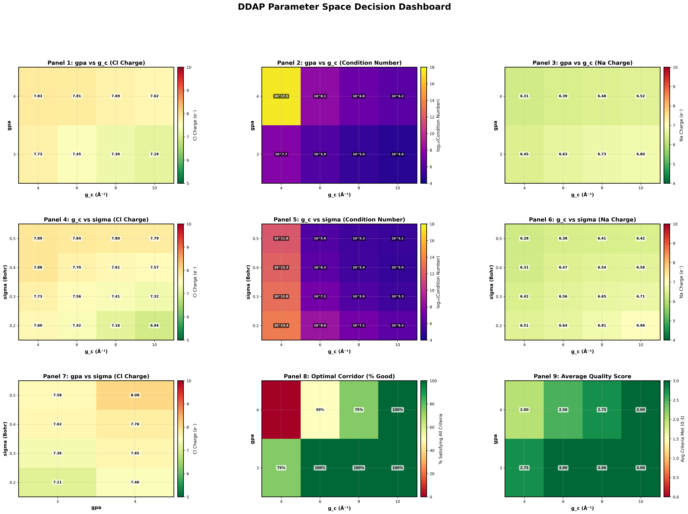

In the summer after my second year at IIT Bombay, I emailed Prof. Sudarshan Vijay because I wanted to try research at the intersection of computation and science.

I had enjoyed working with simulations and was becoming interested in what computation could help us understand about physical systems. But I had very little background in density functional theory. I certainly did not have a plan to develop a new charge-fitting method.

Prof. Vijay gave me a paper by Peter E. Blöchl, published in 1995: *Electrostatic decoupling of periodic images of plane-wave-expanded densities and derived atomic point charges*. He asked me to focus on how the charges were constructed and to understand the mathematics behind them. [\[1\]](#papers-code-and-further-reading)

It became the first research paper I worked through in that much detail. Understanding a paragraph often meant stopping to learn the physics behind it. Understanding an equation meant figuring out what its symbols represented, how it connected to the previous equation, and how I might implement it.

That reading assignment led to a summer of learning, a semester of experiments, and eventually **opt-DDAP**, a differentiable framework for fitting atom-centred charges to an electronic density. The work became my first research paper, with Prof. Vijay, in the *Journal of Chemical Theory and Computation* in July 2026. [\[2\]](#papers-code-and-further-reading)

The path between those two papers taught me much more than I expected: electrostatics, Fourier transforms, numerical linear algebra, automatic differentiation, and how to ask better questions about a result that looks convincing on a plot.

## Why would we want to put a charge on an atom?

The first question was more basic than any solver: what exactly were we trying to calculate?

A density functional theory calculation gives us an electronic density spread through space. In a molecule or solid, electrons are shared, redistributed and polarized by their environment. They do not come with labels saying which atom owns them.

Yet many useful models describe electrostatics using a small list of atomic charges. Those charges can help us interpret charge transfer or build an inexpensive description of interactions between atoms. Replacing a three-dimensional density with one number per atom is a large compression, so the rule used to do it matters.

I will write the positive electron number density as $n(\mathbf r)$. Its integral gives the number of represented electrons:

$$
N_e=\int_{\mathrm{cell}}n(\mathbf r)\,d^3r.
$$

If an analysis assigns an electron population $p_i$ to atom $i$, its net charge is

$$
Q_i=e\left(Z_i^{\mathrm{val}}-p_i\right).
$$

Here $e$ is the positive elementary charge, and $Z_i^{\mathrm{val}}$ is the ionic reference appropriate to the valence-electron calculation. Gaining electron population makes an atom more negatively charged. The reference must match the electronic-structure dataset: sodium does not necessarily mean one explicitly represented electron if a potential includes semicore states.

This distinction between *electron population* and *net charge* became important throughout the project. A population of 7.5 electrons is not a positive atomic charge of $+7.5e$.

There is no single universal way to assign populations. Bader analysis, for example, divides space into regions using the density. Other approaches use orbital populations or fit an electrostatic potential. DDAP—density-derived atomic point charges—takes a different route: fit a compact, atom-centred model to the density, with particular attention to the components relevant to long-range electrostatics.

That gave the problem a clear purpose. We were looking for a useful physical representation of a continuous distribution.

## The first surprise: changing the representation can change the calculation

The original paper connects charge fitting to a problem in periodic electronic-structure calculations.

Plane-wave calculations naturally describe a repeating cell. For a crystal, that repetition is the intended physical model. For an isolated molecule placed inside a large vacuum cell, its repeated copies are a computational construction. Their electrostatic interactions can remain significant even when the electron clouds no longer overlap appreciably.

Electrostatic decoupling asks how to account for those unwanted image interactions. Reading about this introduced me to Ewald summation, which was part of my initial learning assignment.

The difficulty starts with the Coulomb interaction, proportional to $1/r$. It decays slowly, so directly summing interactions over many periodic images is delicate and inefficient. Ewald's idea is to split it:

$$
\frac{1}{r}
=\frac{\operatorname{erfc}(\alpha r)}{r}
+\frac{\operatorname{erf}(\alpha r)}{r}.
$$

The error function and complementary error function add to one. The parameter $\alpha$ controls how the interaction is divided.

The first term decays quickly and is suitable for a real-space sum. The second is smooth and can be evaluated efficiently in reciprocal space, where its nonzero-frequency kernel contains

$$
\frac{4\pi}{G^2}\exp\!\left(-\frac{G^2}{4\alpha^2}\right).
$$

The Gaussian factor makes large-$G$ contributions decay rapidly. The complete periodic calculation also needs a self-interaction correction and an appropriate treatment of the zero mode and boundary conditions. The splitting parameter changes how work is distributed between the two sums; a converged result should not depend on that arbitrary choice.

What interested me was the reasoning behind the method. A difficult sum became manageable because the interaction was separated into parts that were easier to evaluate in different representations.

Ewald summation and DDAP have different jobs. Ewald evaluates periodic electrostatics. DDAP constructs a compact charge representation that can be useful for electrostatic calculations. Understanding their connection helped me see why fitting charges was worth studying.

## Learning to read a density in two languages

Real space tells us where the density is. Reciprocal space tells us about its spatial wavelengths.

For a periodic density, I use the Fourier convention

$$
n(\mathbf G)=\frac{1}{V}\int_{\mathrm{cell}}
n(\mathbf r)e^{-i\mathbf G\cdot\mathbf r}\,d^3r,
\qquad
n(\mathbf r)=\sum_{\mathbf G}n(\mathbf G)e^{i\mathbf G\cdot\mathbf r}.
$$

The cell volume is $V$, and $\mathbf G$ is a reciprocal-lattice vector. Small $G=|\mathbf G|$ corresponds to slowly varying structure; large $G$ corresponds to finer detail. The zero-frequency component is especially simple:

$$
Vn(\mathbf 0)=N_e.
$$

Why does low-$G$ information matter for electrostatics? For a physical charge density $\rho_{\mathrm{ch}}$, Poisson's equation is

$$
\nabla^2\phi=-\frac{\rho_{\mathrm{ch}}}{\varepsilon_0}.
$$

In reciprocal space, for $\mathbf G\neq0$, this becomes

$$
\phi(\mathbf G)=\frac{\rho_{\mathrm{ch}}(\mathbf G)}{\varepsilon_0G^2}.
$$

The inverse-square factor makes long-wavelength charge errors important for the electrostatic potential. This is one reason a fitting method designed for electrostatics should not treat every spatial frequency as equally important.

There is a second connection. For a localized charge distribution, define its continuous Fourier transform without the cell-volume factor. Expanding its exponential around zero wavevector gives

$$
\widetilde{\rho}_{\mathrm{ch}}(\mathbf k)
=Q_{\mathrm{tot}}-i\mathbf k\cdot\mathbf p
-\frac{1}{2}\sum_{\mu,\nu}k_\mu k_\nu M_{\mu\nu}+\cdots.
$$

Here $Q_{\mathrm{tot}}$ is the total charge, $\mathbf p=\int\mathbf r\,\rho_{\mathrm{ch}}(\mathbf r)\,d^3r$ is the dipole, and $M_{\mu\nu}=\int r_\mu r_\nu\rho_{\mathrm{ch}}(\mathbf r)\,d^3r$ is the second-moment tensor, from which the quadrupole is constructed.

The coefficients near zero wavevector therefore contain information about the multipole moments that describe the distant field. This expansion explains the physical motivation. Periodic crystals have additional subtleties involving cell choice and polarization, so it should not be read as an unrestricted definition of a crystal's dipole.

I began to see Fourier transforms as more than a convenient computational tool. They exposed which parts of the density mattered for the physical quantity we wanted.

## Building the DDAP model, one Gaussian at a time

DDAP represents the density using Gaussian functions centred on atoms. Around atom $i$, at position $\mathbf R_i$, a normalized Gaussian of width $\sigma_k$ is

$$
g_{ik}(\mathbf r)=
\frac{1}{\pi^{3/2}\sigma_k^3}
\exp\!\left[-\frac{|\mathbf r-\mathbf R_i|^2}{\sigma_k^2}\right].
$$

In a periodic cell, the corresponding images are included. The model density is a weighted sum:

$$
\widehat n(\mathbf r)=\sum_i\sum_k q_{ik}g_{ik}(\mathbf r),
\qquad p_i=\sum_k q_{ik}.
$$

The Gaussian integrates to one, so its coefficient has the meaning of an electron population contribution. Individual coefficients are fitting variables and need not all be positive. The summed atomic populations and reconstructed density need to be interpreted and checked.

Using several widths lets the basis describe both narrower and more diffuse structure. We arrange them geometrically:

$$
\sigma_k=\sigma_{\mathrm{start}}f^{\,k-1},
\qquad k=1,\ldots,N_{\mathrm{GPA}}.
$$

The starting width sets the smallest Gaussian, the spacing factor $f$ determines how quickly the widths grow, and $N_{\mathrm{GPA}}$ is the number of Gaussians per atom.

Gaussians are convenient because their Fourier transforms have a simple form:

$$
g_{ik}(\mathbf G)=
\frac{1}{V}
e^{-i\mathbf G\cdot\mathbf R_i}
\exp\!\left(-\frac{\sigma_k^2G^2}{4}\right).
$$

The phase records the atom's position. The exponential envelope controls the spatial frequencies that the Gaussian can represent. A wide real-space Gaussian has a narrow reciprocal-space envelope; a narrow real-space Gaussian retains more high-frequency content.

This made the width parameter much more concrete to me. Changing it changes the model's spatial resolution and how similar its basis functions are to one another.

The conventional fit gives greater weight to low-frequency information:

$$
J(\mathbf q)=\frac{V}{2}\sum_{\mathbf G\neq0}
w(\mathbf G)\left|n(\mathbf G)-\widehat n(\mathbf G)\right|^2.
$$

The weight used in the formulation is

$$
w(G)=
\begin{cases}
\displaystyle\frac{4\pi(G^2-g_c^2)^2}{G^2g_c^2},
&0<G<g_c,\\
0,&G\geq g_c.
\end{cases}
$$

The zero mode is handled separately through the total electron count. The reciprocal cutoff $g_c$ sets the range of frequencies included in the weighted fit. The weight emphasizes small nonzero $G$ and goes smoothly to zero at the cutoff.

A larger cutoff includes more frequency components. Whether that improves the fit depends on the density, basis and numerical problem. It is not automatically better, and a higher condition number alone cannot tell us that high-frequency information is “noise.”

, Figure 1. The coloured curves show how the cutoff changes the fitting weights, while the black curve shows the reference DFT density spectrum. This is the original published plot.")

At this point, the method had become a set of linked choices I could investigate: the number of basis functions, their widths, their spacing, and the weighting of the information they were trying to reproduce.

## From the paper to VASP data and Python experiments

I wanted to continue the project after the summer. During the following semester, much of my work was learning the VASP workflow, implementing the charge-fitting procedure in Python, and running small experiments.

DFT itself was another major part of the learning. In the Kohn–Sham approach, an effective one-electron problem is solved self-consistently. In atomic units, its schematic form is

$$
\left[-\frac{1}{2}\nabla^2+v_{\mathrm{ext}}
+v_{\mathrm H}[n]+v_{\mathrm{xc}}[n]\right]\psi_j
=\epsilon_j\psi_j,
\qquad
n(\mathbf r)=\sum_j f_j|\psi_j(\mathbf r)|^2.
$$

The effective potential depends on the density, and the density depends on the occupied orbitals. The calculation iterates until those are consistent. For periodic systems, the state index includes band and wavevector information, with the corresponding occupations and sampling weights.

Our published calculations used VASP with the PBE exchange-correlation functional and projector augmented-wave, or PAW, datasets. PBE approximates the exchange-correlation contribution. PAW connects a computationally convenient smooth description to atom-centred information needed near nuclei. These choices determine the density that the fitting procedure receives. [\[2\]](#papers-code-and-further-reading)

The practical workflow has several parts. POSCAR describes the structure, POTCAR supplies the atomic datasets, KPOINTS controls reciprocal-space sampling, and INCAR sets calculation options. The density can then be read from CHGCAR or passed through an interface. The public opt-DDAP tutorial documents both file and plugin workflows. [\[4\]](#papers-code-and-further-reading)

I also had to learn to distinguish settings that sounded similar. VASP's plane-wave energy cutoff controls the electronic-structure basis. The DDAP cutoff $g_c$ controls the density fit. A Gaussian occupation broadening in the DFT calculation is different again from the Gaussian widths used to represent the density.

The paper reports Gaussian broadening of 0.1 eV and a plane-wave cutoff of 262 eV for the charged-defect calculations. Those reported settings do not constitute a complete input deck or a universal recommendation for other materials.

Data handling required just as much care. A density array needs a known unit and normalization convention. After conversion to physical electron density, a uniform grid with $M$ points should satisfy

$$
\frac{V}{M}\sum_{j=1}^{M}n_j\approx N_e.
$$

With an unnormalized discrete FFT, the Fourier coefficients in my convention require a factor of $1/M$. That factor must appear exactly once. The raw CHGCAR representation and any parser's output must be distinguished from the physical density used in this equation. VASP's documentation describes the file's grid and density conventions. [\[5\]](#papers-code-and-further-reading)

These details made the equations feel real. A missing volume factor, a mismatched electron reference or an inconsistent lattice convention can change the answer even when the code runs without an error.

## A semester of changing parameters—and asking why the answers changed

NaCl was a useful starting system because its ionic character gave us an interpretable test case. I then explored defective structures and different cell sizes, comparing parameter choices and solver behaviour.

I varied Gaussian widths, the number of Gaussians per atom and the reciprocal cutoff. I plotted populations, density reconstructions and matrix diagnostics. Discussions with Prof. Vijay helped me connect changes in those plots to the equations.

Some settings produced sensible-looking populations. Others produced large positive and negative coefficients, or charge-transfer behaviour that was difficult to justify. The important observation was the sensitivity: relatively modest changes in the fitting setup could lead to very different answers.

That made the question more interesting. How could a method with a clear physical motivation become so difficult to use consistently?

I had to return to linear algebra.

## What a condition number was trying to tell me

For fixed Gaussian parameters, finding the coefficients is a linear fitting problem. If I combine the atom and width labels into a single index $\alpha$, the normal equations involve a matrix $A$ and vector $b$:

$$
A_{\alpha\beta}
=V\,\operatorname{Re}\sum_{\mathbf G\neq0}
w(\mathbf G)g_\alpha^*(\mathbf G)g_\beta(\mathbf G),
$$

$$
b_\alpha
=V\,\operatorname{Re}\sum_{\mathbf G\neq0}
w(\mathbf G)g_\alpha^*(\mathbf G)n(\mathbf G).
$$

The matrix measures how similar the basis functions are under the chosen weighting. If two basis functions look almost the same over the fitted frequencies, the data has difficulty deciding how much coefficient to assign to each.

Suppose two functions are nearly identical. Adding an amount to one coefficient and subtracting nearly the same amount from the other may barely change the reconstructed density:

$$
(q_1+\delta)g_1+(q_2-\delta)g_2
=q_1g_1+q_2g_2+\delta(g_1-g_2).
$$

When $g_1-g_2$ is small, the density can change very little even as the coefficients change considerably.

That is the physical meaning of the numerical difficulty. The representation permits different assignments that look similar to the fitting objective. The fitting data does not strongly distinguish them.

The two-norm condition number is

$$
\kappa_2(A)=\frac{s_{\max}(A)}{s_{\min}(A)},
$$

where the $s$'s are singular values. A small minimum singular value signals a direction in coefficient space that the matrix constrains weakly. In a sensitive problem, small input or rounding errors can create much larger coefficient changes.

There is an additional reason to watch the matrix construction. If $A=B^\dagger B$, where $B$ is the weighted design matrix, then for a full-column-rank basis

$$
\kappa_2(A)=\kappa_2(B)^2.
$$

Forming normal equations can therefore make conditioning more severe.

, Figure 2. Black curves are the reference densities; dashed green curves are the reconstructions. Original axes, annotations and panels are retained.")

This also changed how I interpreted residuals. A small value of $\|A\mathbf q-\mathbf b\|$ says that the normal equations have been satisfied accurately. It does not say that $\|\widehat n-n\|$ is small, or that the atomic populations are uniquely determined.

In least squares, the normal equations require the reconstruction error to be orthogonal to the fitted basis. A nonzero reconstruction error can satisfy that condition extremely well.

That distinction is one of the most useful lessons I took from the project. Numerical solution accuracy, density reconstruction and physical interpretation are related, but they are different things to check.

## The first change: reconsidering how we solved for the coefficients

The original constrained fit enforces the total electron population:

$$
\mathbf c^{\mathsf T}\mathbf q=N_e,
\qquad c_\alpha=1.
$$

Introducing a Lagrange multiplier gives the augmented system

$$
\begin{pmatrix}A&\mathbf c\\\mathbf c^{\mathsf T}&0\end{pmatrix}
\begin{pmatrix}\mathbf q\\\lambda\end{pmatrix}
=
\begin{pmatrix}\mathbf b\\N_e\end{pmatrix}.
$$

The multiplier adjusts the fitting equations so that the coefficients also obey the total-population constraint. It is a sound mathematical construction. The numerical difficulty appears when the matrix and solution procedure cannot reliably resolve the directions introduced by the chosen basis.

We explored a different practical route: use the Moore–Penrose pseudoinverse for the unconstrained fit, followed by population normalization.

To understand why that can help, write the singular-value decomposition as

$$
A=U\Sigma V^\dagger,
\qquad
\mathbf q_{\mathrm{raw}}=A^+\mathbf b.
$$

A numerical pseudoinverse reciprocates the singular values that are sufficiently large and discards directions below a chosen tolerance. Trying to invert a tiny singular value can amplify small errors enormously; truncation avoids insisting on information that the numerical problem does not reliably contain.

It does not magically lower the condition number of the original matrix. It changes which directions are retained in the solution.

We then rescale the raw coefficients:

$$
q_\alpha
=q_\alpha^{\mathrm{raw}}
\frac{N_e}{\sum_\beta q_\beta^{\mathrm{raw}}}.
$$

For a valid nonzero denominator, the sum becomes the target population. A near-zero denominator needs explicit handling; it cannot be made safe simply by dividing.

This procedure is generally different from solving the original constrained minimization exactly. It is a practical reformulation whose usefulness must be evaluated through its resulting populations and reconstruction.

Other numerical approaches are possible, including stable constrained QR or SVD solvers and regularized fits. Our contribution was to investigate a workable route that could become part of an optimizable pipeline. The pseudoinverse was an important ingredient, but the parameter choices still remained.

## The second change: letting the fit adjust its own parameters

Even with a more usable solver, I could still spend a long time trying widths and cutoffs by hand.

That suggested the next question: could we make the fitting procedure respond directly to the reconstruction error?

The three continuous parameters were

$$
\boldsymbol\theta=(\sigma_{\mathrm{start}},f,g_c).
$$

Changing any of them changes the fit. The widths change the Gaussian basis. The cutoff changes the weights. Together, those changes alter $A$, $b$, the fitted coefficients and the reconstructed density.

We implemented that chain of operations in PyTorch and used automatic differentiation to obtain gradients with respect to the parameters. This became the central idea of **opt-DDAP**.

, Figure 3. The DFT density is prepared once; the optimization loop updates the Gaussian and cutoff parameters through automatic differentiation.")

At each step, we evaluate an unweighted reconstruction loss over the nonzero reciprocal vectors:

$$
\mathcal L(\boldsymbol\theta)=
\sum_{\mathbf G\neq0}
\left|\widehat n_{\boldsymbol\theta}(\mathbf G)-n(\mathbf G)\right|^2.
$$

There are two levels here. The inner weighted fit determines the coefficients for the current parameters. The outer loss evaluates the resulting density reconstruction and guides the parameter updates.

This distinction matters. The outer objective is not the algebraic residual of the inner solve, and it is not a direct electrostatic-energy loss. It measures the quality of the resulting density representation.

The coefficients themselves depend on the parameters. The derivative therefore includes both their response and the change in the basis:

$$
\frac{\partial\widehat n}{\partial\theta_j}
=\sum_\alpha
\left[
\frac{\partial q_\alpha}{\partial\theta_j}g_\alpha
+q_\alpha\frac{\partial g_\alpha}{\partial\theta_j}
\right].
$$

Automatic differentiation applies the chain rule through the implemented operations. Treating the fitted coefficients as constants would miss the first term.

We used Adam to update the parameters. Conceptually, it follows gradient information while adapting step sizes using running estimates of the gradients and their squared magnitudes. The reported runs used a learning rate of 0.01 and up to 100 iterations. Parameter bounds kept the search within a chosen range: starting widths from 0.2 to 0.6 Å, spacing factors from 1.15 to 1.5, and cutoffs from 4 to 12 Å⁻¹. [\[2\]](#papers-code-and-further-reading)

The number of Gaussians per atom remained a discrete choice. Optimization reduced manual tuning; it did not eliminate every modelling decision.

This work also changed how I thought about automatic differentiation. Its value extends well beyond training neural networks. Here, it helped optimize a physical fitting procedure with a linear solve inside it. We kept the DFT density fixed and differentiated the postprocessing calculation.

Differentiability still needs numerical care. Rank changes in a truncated pseudoinverse and parameter bounds can complicate gradients. The benefit comes from a carefully implemented computational graph and sensible tests, rather than from using a particular library alone.

## What we started to see

We tested the method on NaCl vacancy cells and a MoS₂ monolayer. These gave us different challenges.

The NaCl examples included seven- and 63-atom single-vacancy cells. Their optimized planar density profiles closely followed the DFT reference in the reported comparisons. The larger example also changed the vacancy concentration and image separation, so it was a test across different defect environments as well as different cell sizes.

MoS₂ introduced a different kind of density: a layered material with appreciable bonding density between atoms. The atom-centred Gaussian representation captured the overall profile through the layer. That was encouraging, while also illustrating why spherical functions centred only on atoms have limits.

A planar average is a useful view of a three-dimensional density, but it cannot reveal every three-dimensional error. The results support the tested reconstructions; they do not make every aspect of the density or electrostatic potential exact.

, Figure 4: two NaCl vacancy cells, monolayer MoS₂, and the vacancy-minus-bulk difference. Black curves are the DFT reference; dashed red curves are opt-DDAP. The panels and their original numerical labels are unchanged.")

The supporting information separates the solver change from parameter optimization and includes tests from poor starting parameters. One three-Gaussian case reduced its reconstruction loss from 2.3 to 0.016, while a seven-Gaussian case decreased from 0.29 to 0.031. The more compact basis performed better in those examples. [\[3\]](#papers-code-and-further-reading)

We also looked at the difference between defective and bulk densities:

$$
\Delta n(\mathbf r)
=n_{\mathrm{defect}}(\mathbf r)-n_{\mathrm{bulk}}(\mathbf r).
$$

This asks a harder question than fitting two large total densities separately: can the representation retain the smaller difference between them? Both fits used a common set of centres for that comparison.

The reported difference profile captured the negative feature near the removed Cl site. Its integrated change was seven electrons fewer, consistent with the represented electron counts. That includes the missing atom's density as well as changes around it; it is not a statement that the vacancy has a net charge of $-7e$.

Another useful test was initialization sensitivity. In the paper's four-start experiment, the final starting-width parameter lay between 0.478 and 0.506 Å, while the final cutoff varied more widely. The Cl populations ranged from 7.458 to 7.574 electrons—a spread of 0.116 electrons. [\[2\]](#papers-code-and-further-reading)

, Figure 5. Open circles mark initial settings and squares mark the final settings. Colours show the reconstruction loss; the original legend identifies the four runs.")

The useful conclusion was that different starts produced relatively similar populations in this example, even though the optimizer did not choose identical cutoffs. The width appeared more tightly determined than the cutoff.

I prefer reporting the absolute population spread because its meaning is clear. With a seven-electron reference for Cl, those populations correspond to net charges from about $-0.458e$ to $-0.574e$. A percentage relative to the full population would describe a different quantity from a percentage relative to the net charge.

The comparisons with Bader analysis were informative for a related reason. The methods gave consistent charge-transfer directions for the studied systems, but different magnitudes. They use different definitions. Agreement on every numerical charge is not the right criterion; the physical purpose of the representation has to guide its evaluation. [\[3\]](#papers-code-and-further-reading)

## Why I cared about the connection to machine learning

During the project, I began reading about machine-learning interatomic potentials. I was fascinated by the possibility of learning complex energy surfaces while respecting structure such as permutation symmetry and rotational behaviour.

I also started to understand why long-range interactions are challenging.

A common local model builds an energy from environments within a finite radius:

$$
E_{\mathrm{local}}=\sum_i
\varepsilon_i\!\left(\mathcal N_i(r_c)\right).
$$

Such a model does not explicitly distinguish changes outside that neighbourhood. Electrostatics can connect distant regions, particularly when charges or polarization change.

One approach is to combine a local description with an explicit long-range contribution:

$$
E_{\mathrm{model}}
=E_{\mathrm{local}}+E_{\mathrm{electrostatic}}.
$$

Useful charges could support that second term or provide reference labels for a model that predicts them. That was an important motivation for studying DDAP and making its fitting procedure more systematic.

There are additional requirements before this becomes a reliable force model. Charge response, energy consistency, derivatives with respect to positions, and possible double counting all need attention. Our paper develops and tests the charge-fitting framework; it does not demonstrate that every downstream machine-learning potential will improve.

For me, that connection widened the project. Understanding a charge-fitting method led naturally to questions about how we represent interactions across different length scales.

## From experiments to a paper

The work eventually became *opt-DDAP: Optimizable Density-Derived Atomic Point Charges via Automatic Differentiation*, with me as first author and Prof. Sudarshan Vijay as coauthor. It was accepted in July 2026 and published in JCTC. [\[2\]](#papers-code-and-further-reading)

My contribution grew through implementing the framework, learning the DFT workflow, running parameter studies, examining numerical behaviour and helping develop the differentiable implementation. Prof. Vijay's guidance and our discussions shaped the work throughout. We also benefited from discussions with Prof. Ananth Govind Rajan, acknowledged in the paper.

The calculation work used IIT Bombay's NSM PARAM Rudra computing facility. The implementation and a tutorial are available through the atomic-recipes project. [\[4\]](#papers-code-and-further-reading)

Seeing this become my first paper mattered a great deal to me. I had started by learning vocabulary and working through someone else's equations. Over time, I was able to ask why an implementation behaved as it did, design experiments around that question, and contribute to a method of our own.

The contribution is specific and useful: opt-DDAP combines a numerical reformulation with automatic differentiation to adapt the continuous parameters of a physically motivated density-fitting procedure. It makes those choices more systematic and provides encouraging results for the systems we studied.

The next step I find especially interesting is to connect those charge representations more directly to electrostatic potentials, energies and downstream models. That would test the usefulness of the charges against the quantities that motivated the project in the first place.

## What the 1995 paper left me with

I learned that understanding an equation includes understanding its assumptions, its numerical implementation and the physical quantity it is meant to describe.

I learned to ask what a diagnostic actually measures. A small residual, a good-looking profile and a stable atomic population each tell us something, but none can stand in for all the others.

I learned that a basis can fit a density without uniquely determining its coefficients. More flexibility can help representation and hurt identifiability at the same time.

And I learned how a research question can develop gradually. I did not begin by deciding to write a JCTC paper. I began with a paper I wanted to understand, then code I wanted to make work, then results I wanted to explain.

Blöchl's paper gave me a way into computational research. Working on opt-DDAP taught me how to stay with a question long enough to make a contribution.

## Papers, code and further reading

**[1] The paper that started the project.** P. E. Blöchl, “Electrostatic decoupling of periodic images of plane-wave-expanded densities and derived atomic point charges,” *Journal of Chemical Physics* **103**, 7422–7428 (1995). [Read the paper](https://doi.org/10.1063/1.470314).

**[2] Our paper.** Mohith H and Sudarshan Vijay, “opt-DDAP: Optimizable Density-Derived Atomic Point Charges via Automatic Differentiation,” *Journal of Chemical Theory and Computation* (2026). [Read the paper](https://doi.org/10.1021/acs.jctc.6c00727). The mathematical formulation, computational details and main validation examples discussed here are reported there.

**[3] Supporting information.** Fixed-parameter solver comparisons, optimization tests, population normalization, comparisons with other analyses and multiple-vacancy examples. [Read the supporting information](https://acs.figshare.com/articles/journal_contribution/opt-DDAP_Optimizable_Density-Derived_Atomic_Point_Charges_via_Automatic_Differentiation/32920371).

**[4] Implementation and tutorial.** The [atomic-recipes repository](https://gitlab.com/electrocatalysis-group/atomic-recipes), including the [opt-DDAP module](https://gitlab.com/electrocatalysis-group/atomic-recipes/-/blob/8fc5ecd48f9d9c52112a93da4cf54c7019d1aa1b/src/atomic_recipes/electrostatics/opt_ddap.py) and [usage tutorial](https://gitlab.com/electrocatalysis-group/atomic-recipes/-/blob/8fc5ecd48f9d9c52112a93da4cf54c7019d1aa1b/docs/source/tutorial_optddap.rst), linked to the revision consulted for this article.

**[5] Density-file conventions.** [VASP's CHGCAR documentation](https://vasp.at/wiki/CHGCAR). Check both the source file's convention and what a chosen parser returns before applying normalization.

*All images in this article come directly from my SLP records or the published opt-DDAP paper. The paper figures were extracted without redrawing their curves, labels or diagrams; each caption identifies its source. The chronological account draws on my project notes and semester reports, and the explanations use a consistent positive-electron-density convention throughout.*
